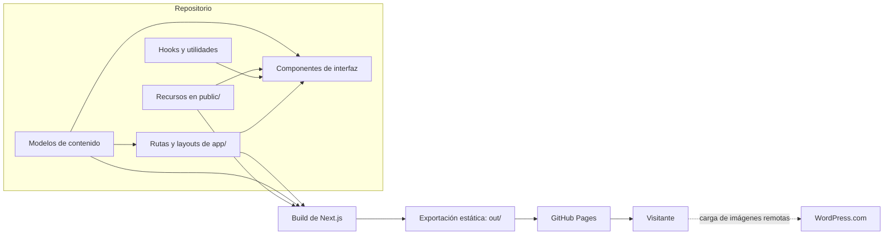

# Arquitectura de la aplicación

## Propósito y alcance

Este documento describe la arquitectura observada en el repositorio de la Hermandad de Cargadores de San Martín de Porres de Cruz Blanca. La aplicación es un sitio institucional desarrollado con Next.js App Router, React y TypeScript. Se compila como sitio estático y se publica en GitHub Pages; no incluye un servidor de aplicación ni una base de datos en tiempo de ejecución.

## Vista general

El contenido local se importa desde módulos TypeScript y los archivos de `public/`. Durante `next build`, Next.js genera HTML y recursos estáticos en `out/`. GitHub Pages sirve esos archivos. Algunas imágenes se solicitan desde WordPress.com cuando el visitante abre el sitio, por lo que son una dependencia externa en tiempo de ejecución.

## Capas y responsabilidades

| Capa | Responsabilidad | Ubicaciones principales |
| --- | --- | --- |
| Enrutamiento y composición | Define URLs, metadatos por página y composición de vistas. | [`app/`](../app/) |
| Presentación | Implementa secciones, páginas funcionales y elementos reutilizables. | [`components/`](../components/) |
| Contenido | Mantiene datos editoriales, navegación, recursos remotos y configuración SEO. | [`models/`](../models/) |
| Comportamiento reutilizable | Contiene hooks y funciones independientes de la interfaz. | [`hooks/`](../hooks/), [`utils/`](../utils/) |
| Archivos estáticos | Guarda imágenes, documentos, audio y otros recursos servidos junto al sitio. | [`public/`](../public/) |
| Automatización | Ejecuta controles, genera la exportación y la publica. | [`.github/workflows/deploy.yml`](../.github/workflows/deploy.yml) |

La organización de `components/` sigue las áreas funcionales (inicio, hermandad, archivo, contacto, festividad, entre otras). `components/shared/` concentra piezas comunes, como encabezado, pie de página, audio y cuenta regresiva. Las páginas de `app/` conectan esos componentes con los modelos y los metadatos.

## Rutas y generación de páginas

El sitio usa segmentos de ruta del App Router. `trailingSlash: true` produce URLs con barra final. Las rutas dinámicas deben tener sus parámetros definidos al compilar y no admiten nuevas páginas generadas en una petición posterior.

| URL | Implementación | Fuente de contenido |
| --- | --- | --- |
| `/` | [`app/page.tsx`](../app/page.tsx) | Secciones de inicio y modelos de `models/home/`. |
| `/contacto/` | [`app/contacto/page.tsx`](../app/contacto/page.tsx) | Vista y datos de contacto. |
| `/vida/` | [`app/vida/page.tsx`](../app/vida/page.tsx) | Vida comunitaria y prácticas. |
| Páginas institucionales, por ejemplo `/hermandad/historia/`, `/archivo/` y `/san-martin-de-porres/` | [`app/[...slug]/page.tsx`](../app/%5B...slug%5D/page.tsx) | Entradas de `institutionalPages` en `models/hermandad/institutional-pages.ts`. |
| `/blog/` | Ruta institucional procesada por el segmento catch-all | Colección editorial definida en el modelo institucional. |
| `/blog/[slug]/` | [`app/blog/[slug]/page.tsx`](../app/blog/%5Bslug%5D/page.tsx) | Artículos de `models/blog/news.ts`. |
| `/sitemap.xml` y `/robots.txt` | [`app/sitemap.ts`](../app/sitemap.ts) y [`app/robots.ts`](../app/robots.ts) | Rutas institucionales, artículos y configuración SEO. |

La ruta catch-all exporta `generateStaticParams()` a partir del catálogo institucional y tiene `dynamicParams = false`. La ruta de artículos usa el mismo patrón para generar una página por artículo. Si el catálogo de noticias está vacío, el código define una página de estado vacío. Las rutas antiguas también están enumeradas en el catch-all y se procesan mediante llamadas a `redirect()`; conviene comprobar su resultado en la exportación y en GitHub Pages al modificar esos alias.

## Renderizado y comportamiento en el navegador

Las páginas y componentes son Server Components por defecto. En la exportación estática se renderizan durante el build. Los módulos marcados con `"use client"` se usan donde hace falta estado, efectos o APIs del navegador; por ejemplo, el menú, el carrusel multimedia y su lightbox, filtros, reproductor de audio, animaciones de aparición y cuenta regresiva. El hook `use-november-countdown.ts` coordina el estado de la cuenta regresiva con sus funciones de fecha en `utils/`.

La carga inicial sigue siendo HTML prerenderizado; JavaScript del cliente habilita las interacciones. El sitio no tiene rutas API, persistencia propia ni CMS conectado en este repositorio. La edición del contenido se realiza en los modelos y los cambios se publican mediante una nueva compilación.

## Contenido y recursos

- El contenido por área se mantiene en `models/home/`, `models/hermandad/`, `models/blog/`, `models/archivo/`, `models/contacto/`, `models/vida/`, `models/san-martin/` y `models/fiesta/`.
- `models/shared/navigation.ts` centraliza los enlaces de navegación. `models/shared/assets.ts` ofrece helpers para URLs de imágenes alojadas en WordPress.com.
- Los artículos guardan su contenido como Markdown y la vista de artículo lo convierte a elementos HTML con `react-markdown`.
- `public/` contiene recursos versionados localmente, como documentos descargables y audio. El archivo fotográfico incluye recursos locales y también referencias a imágenes remotas.
- `models/seo/site.ts` centraliza el dominio y la construcción de URLs canónicas. Los esquemas de datos estructurados se definen en `models/seo/schemas.ts` y se insertan mediante `components/seo/json-ld.tsx`.

## Estilos, SEO y configuración

Los estilos globales y las variables visuales están en `app/globals.css`; Tailwind CSS 4 se integra mediante PostCSS. El layout raíz, `app/layout.tsx`, declara el idioma, las fuentes, los metadatos base y las piezas compartidas que envuelven las páginas.

Las páginas definen metadatos específicos. El sitemap se genera a partir de los modelos institucionales y del blog, y `robots.ts` publica su ubicación. Los datos JSON-LD describen la organización, el sitio, las páginas, artículos y entidades relacionadas.

Las variables de compilación usadas por SEO son `NEXT_PUBLIC_SITE_URL` y `NEXT_PUBLIC_BASE_PATH`. El workflow configura el dominio de producción y una base vacía para servir el sitio desde la raíz del dominio. `NEXT_PUBLIC_BASE_PATH` se utiliza en las URLs canónicas; al desplegar bajo una subruta también se debe alinear la configuración `basePath` de Next.js y revisar enlaces y recursos.

## Compilación, calidad y despliegue

La configuración `output: "export"` genera el directorio `out/`; `images.unoptimized: true` evita depender del optimizador de imágenes de un servidor Next.js. No se debe editar `out/` manualmente porque es una salida generada.

El workflow de GitHub Actions se activa con cambios en `main` o manualmente. Primero ejecuta un control de alertas de seguridad con CodeQL y Dependabot. Después usa Node.js 22, instala dependencias con `pnpm install --frozen-lockfile`, ejecuta Vitest con un umbral de cobertura mínimo de 75 %, compila el sitio, crea `.nojekyll`, sube `out/` como artefacto de Pages y despliega el artefacto.

Para desarrollo local se usan `pnpm dev`, `pnpm lint`, `pnpm test` y `pnpm build`. Vitest corre con React Testing Library y jsdom; la configuración de cobertura incluye `app/`, `components/`, `hooks/` y `utils/`.

## Límites y consideraciones de evolución

- Cada nueva página dinámica debe incorporarse a los parámetros estáticos de compilación y, cuando corresponda, al sitemap.
- Los cambios de contenido requieren compilar y desplegar de nuevo; no hay publicación dinámica ni edición en un CMS desde el sitio.
- Los recursos remotos dependen de la disponibilidad de WordPress.com. Las fuentes de `next/font/google` se resuelven durante la compilación, por lo que el entorno de build necesita acceso a ellas.
- La exportación estática no proporciona funciones que requieren un servidor de Next.js, como respuestas personalizadas por petición, mutaciones de servidor o generación incremental. Si se necesita alguna de esas capacidades, debe incorporarse un servicio externo o cambiar el modelo de alojamiento.
- Los redireccionamientos heredados están implementados desde una ruta dinámica estática; verificar sus URLs publicadas al cambiar la configuración de rutas o el hosting.
